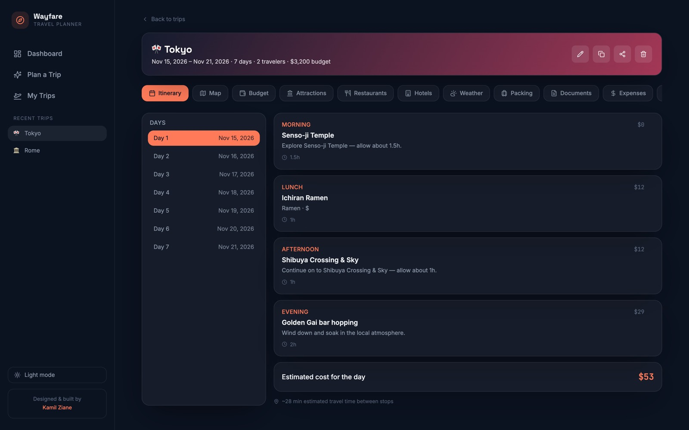

# Wayfare — Travel Planner

Enter a destination, dates, budget, travellers and interests, and get a full
day-by-day plan: attractions, restaurants, hotels, a budget breakdown, weather,
a packing list, travel documents, an expense tracker and a trip assistant that
answers questions about *your* trip.

**Live demo:** https://wayfareziane.netlify.app/



## What I focused on

Product design more than anything: how to fit a lot of trip information into
one place without it feeling heavy. The app has 11 views per trip (itinerary,
map, budget, attractions, restaurants, hotels, weather, packing, documents,
expenses, assistant), a dashboard across trips, and light and dark themes.

## How it works (honestly)

- **Itineraries come from templates, not a language model.** Paris, Tokyo,
  Rome, Bali and New York have hand-written templates. Any other destination
  gets a generic but complete plan built from your inputs.
- **The trip assistant is rule-based.** It answers from the trip's own data
  (budget, days, places) rather than calling an AI API.
- **The map is a styled placeholder** (pins on a canvas) so the app works
  without API keys.
- **No backend.** Everything lives in React state, so trips reset on reload.

I wrote it this way so it runs anywhere for free. Each of these is a clear
place to plug in a real service: an LLM for itineraries and the assistant,
Mapbox for the map, a database for persistence.

## Run it

```bash
npm install
npm run dev      # local server with auto-rebuild
npm run bundle   # production build of bundle.js
```

Or open `index.html` directly; `bundle.js` is committed so it works without
building.

Built with React 18, Recharts, lucide-react, Tailwind CSS and esbuild. The
whole app is in `src/TravelPlanner.jsx`.

---

Built by [Kamil Ziane](https://kamilziane.netlify.app/).
